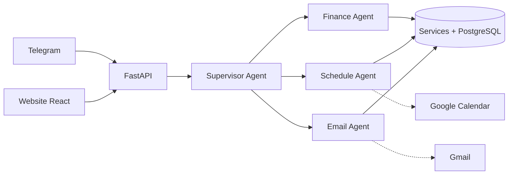

# Trợ lý cá nhân Multi-Agent (ReAct)

> Hệ thống nhiều AI agent theo khung **ReAct** giúp quản lý **chi tiêu**, **lịch sinh hoạt** và **email** hằng ngày — điều khiển qua **Telegram**, quản lý trên **website**, và **truy vết được chính xác prompt + tool** mà agent đã dùng ở từng bước.


> 🚧 Dự án đang được xây dựng **từng bước để vừa làm vừa học** — xem [Lộ trình](#lộ-trình). Ảnh demo sẽ được thêm ở bước 20.

---

## 1. Dự án giải quyết vấn đề gì?
- Ghi chi tiêu hằng ngày rất phiền → chỉ cần **nhắn, chụp hóa đơn hoặc nói** vào Telegram.
- Lịch và việc cần làm rời rạc → agent **gợi ý xếp việc vào khung giờ trống** và nhắc lịch.
- Hộp thư quá tải → agent **tóm tắt, phân loại, soạn nháp** — và **chỉ gửi khi bạn duyệt**.

## 2. Tính năng (dự kiến)
| Agent | Việc làm |
|---|---|
| **Finance** | Ghi thu/chi theo danh mục (ăn uống, di chuyển, mua sắm, giải trí, khác, thu nhập, phụ cấp gia đình); tổng chi, tổng thu, **chi ròng = chi − thu**; ngân sách |
| **Schedule** | Đặt lịch, tìm khung trống, gợi ý xếp việc, nhắc lịch, đồng bộ Google Calendar |
| **Email** | Thu thập, tóm tắt, phân loại mail; soạn nháp; gửi **sau khi người dùng duyệt** |
| **Supervisor** | Hiểu yêu cầu và giao việc cho đúng agent |
| **Briefing** | Bản tin 7h sáng & tổng kết 21h tối |

Thêm: đọc **ảnh hóa đơn** (Gemini vision) và **tin nhắn thoại** (faster-whisper chạy local).

## 3. Kiến trúc



Mọi agent được bao quanh bởi **7 harness**:

| Harness | Trách nhiệm | Thư mục |
|---|---|---|
| Context | Prompt, memory, skills, ghép ngữ cảnh | `backend/app/harness/context/` |
| Tool | Registry, schema, thực thi, mức rủi ro | `backend/app/harness/tools/` |
| Orchestration | Vòng ReAct, Supervisor, duyệt, job | `backend/app/harness/orchestration/` |
| Evaluation | Eval offline/online, chấm điểm | `backend/app/harness/evaluation/`, `backend/evals/` |
| Security | Xác thực, mã hoá, chống prompt injection | `backend/app/harness/security/` |
| Governance | Policy-as-code, audit, kill switch | `backend/app/harness/governance/` |
| AgentOps | Trace, metrics, cảnh báo | `backend/app/harness/agentops/` |

Chi tiết: [PLAN.md](PLAN.md) · [docs/02-architecture.md](docs/02-architecture.md)

## 4. Một yêu cầu được xử lý thế nào?
Mỗi yêu cầu chạy qua **vòng ReAct** ([react_loop.py](backend/app/harness/orchestration/react_loop.py)): model suy nghĩ (Thought) → đề nghị gọi tool (Action) → **code của mình** chạy tool và gửi kết quả lại (Observation) → lặp tới khi model trả lời xong hoặc chạm giới hạn bước. Mọi bước được ghi vào trace JSONL.

Trace thật (bước 2, `gemini-3.5-flash`):
```
USER: Hôm nay là ngày mấy? Còn bao nhiêu ngày nữa đến Tết Dương lịch 2027, và nếu từ hôm nay
      mỗi ngày tôi tiết kiệm 85k thì đến hôm đó tôi có bao nhiêu tiền?

── Bước 1 · 2979 ms · tokens in=316
  [THOUGHT]     …First, I need to pinpoint today's date… then days until January 1st, 2027…
  [ACTION]      get_current_time({})
  [OBSERVATION] Friday 13/11/2026 21:42 (Asia/Ho_Chi_Minh)
── Bước 2 · 2854 ms · tokens in=745
  [ACTION]      days_between({"start": "2026-11-13", "end": "2027-01-01"})
  [OBSERVATION] 49
── Bước 3 · 2089 ms · tokens in=1116
  [ACTION]      calculate({"expression": "49 * 85000"})
  [OBSERVATION] 4165000
── Bước 4 · 3942 ms · tokens in=1325
  [ANSWER]      Hôm nay là ngày 13/11/2026. Còn 49 ngày nữa là đến Tết Dương lịch 2027 (01/01/2027).
                Nếu mỗi ngày tiết kiệm 85.000đ, đến hôm đó bạn sẽ có 4.165.000đ.
■ OK sau 4 bước · tổng tokens in=3502 out=156 thinking=544
```

## 5. Kết quả benchmark
So sánh **single-agent vs multi-agent** về chất lượng, độ trễ, chi phí. Bảng dưới được **sinh tự động** bởi `backend/benchmarks/report.py` — không điền tay.

<!-- BENCH:START -->
_Chưa có số liệu: benchmark cần ~150 request (vượt gói Gemini miễn phí). Chạy `cd backend; python -m benchmarks.run --delay 5` khi có billing — bảng sẽ tự xuất hiện ở đây._
<!-- BENCH:END -->

## 6. Quyết định thiết kế (ADR)
| ADR | Quyết định | Trạng thái |
|---|---|---|
| [0001](docs/adr/0001-dung-adr.md) | Ghi lại quyết định kiến trúc bằng ADR | Accepted |
| [0002](docs/adr/0002-chon-llm-gemini.md) | Dùng Google Gemini qua SDK `google-genai` | Accepted |
| [0003](docs/adr/0003-tu-viet-vong-react.md) | Tự viết vòng ReAct, `llm_client` trung lập provider, trace JSONL | Accepted |
| [0004](docs/adr/0004-tool-la-lop-mong-boc-service.md) | Tool là lớp mỏng bọc service; con số do code tính | Accepted |
| [0005](docs/adr/0005-phat-trien-theo-eval.md) | Phát triển theo eval; chấm bằng code; ngưỡng 90% + an toàn 100% | Accepted |
| [0006](docs/adr/0006-tu-luu-trace-vao-db.md) | Tự lưu trace vào DB (agent_runs + agent_events), chi phí từ pricing.yaml | Accepted |
| [0007](docs/adr/0007-thuat-toan-xep-lich-xac-dinh.md) | Thuật toán xếp lịch xác định; đề xuất → người dùng đồng ý → áp dụng | Accepted |
| [0008](docs/adr/0008-single-hay-multi-agent.md) | Single vs multi-agent quyết định bằng benchmark (chờ số liệu) | Proposed |
| [0009](docs/adr/0009-email-la-du-lieu-khong-tin-cay.md) | Email là dữ liệu không tin cậy: bọc, gắn cờ, giới hạn tool, chặn gửi ở code | Accepted |
| [0010](docs/adr/0010-thuc-thi-xac-dinh-sau-khi-duyet.md) | Policy-as-code + duyệt; duyệt xong code chạy đúng tham số đã lưu | Accepted |
| [0011](docs/adr/0011-chien-luoc-memory-context.md) | Memory: 6 lượt chữ gần nhất + facts tra khi cần | Accepted |
| [0012](docs/adr/0012-fastapi-react-sqlite.md) | FastAPI + React cùng domain; cookie httpOnly; SQLite → PostgreSQL | Accepted |
| [0013](docs/adr/0013-lich-db-dong-bo-google-calendar.md) | Lịch trong DB + đồng bộ hai chiều Google Calendar | Accepted |
| [0016](docs/adr/0016-sse-cap-nhat-realtime.md) | SSE + listener after_commit cho cập nhật realtime | Accepted |

Danh sách đầy đủ dự kiến: [docs/adr/README.md](docs/adr/README.md)

## 7. Bắt đầu nhanh (trạng thái hiện tại)
Yêu cầu: Python 3.11+, Git.

```powershell
git clone <repo-url>
cd <repo>
python -m venv .venv
.\.venv\Scripts\Activate.ps1
pip install -e "backend[dev]"
copy .env.example .env      # rồi điền khoá vào .env
pytest backend
```
Gemini API key lấy tại https://aistudio.google.com/apikey (điền `GEMINI_API_KEY` trong `.env`).

**Dùng Finance Agent ngay trên terminal** (chạy trong thư mục `backend`):
```powershell
cd backend
python -m app.cli chat              # nhắn: "trưa ăn phở 45k, đổ xăng 60k" · "tháng này tôi chi bao nhiêu?"
python -m app.cli chat --agent schedule   # "chiều mai 3h họp nhóm" · "mai xếp 2 tiếng học tiếng Anh"
python -m app.cli events            # lịch 7 ngày tới + việc cần làm
python -m app.cli summary           # báo cáo tháng này — tính bằng code, không qua LLM
python -m app.cli list              # giao dịch gần nhất
python -m app.cli runs              # các lần chạy gần nhất · `run <id>` xem lại prompt + tool · `stats` thống kê
python -m app.cli approvals         # yêu cầu chờ duyệt (gửi thư, xoá…) · `approve <id>` · `reject <id>` · `audit`
python -m evals.run                 # eval 15 ca với Gemini thật (xem backend/evals/README.md)
```
Dữ liệu lưu ở `backend/data/app.db` (SQLite, không commit).

Các script học tập (`backend/experiments/`):
```powershell
python backend\experiments\first_tool_call.py
python backend\experiments\react_loop_demo.py          # bước 2: vòng ReAct + trace
python backend\experiments\tool_registry_demo.py       # bước 3: schema tự sinh, chặn tool rủi ro
```
### Chạy website
1. `.env`: `WEB_PASSWORD=<mật khẩu>` và `JWT_SECRET=<chuỗi ngẫu nhiên ≥ 32 ký tự>`
   (tạo: `python -c "import secrets; print(secrets.token_urlsafe(48))"`)
2. Build giao diện (cần Node 20+): `cd frontend; npm install; npm run build`
3. Chạy: `cd backend; uvicorn app.main:app --reload` → mở http://localhost:8000
4. Muốn Telegram cập nhật web realtime: `.env` `TELEGRAM_MODE=polling` → bot chạy chung tiến trình web (không cần chạy bot riêng).

Khi sửa giao diện: `cd frontend; npm run dev` → http://localhost:5173 (tự proxy `/api` sang :8000).

### Kết nối Telegram
1. Nhắn [@BotFather](https://t.me/BotFather) → `/newbot` → đặt tên → nhận **token** → `.env`: `TELEGRAM_BOT_TOKEN=...`
2. `cd backend; python -m app.integrations.telegram_bot` → nhắn `/start` cho bot → bot trả lời **chat_id** của bạn.
3. `.env`: `TELEGRAM_ALLOWED_CHAT_IDS=<chat_id>` → chạy lại bot. Chỉ chat_id trong danh sách được dùng.
4. Nhắn bình thường; yêu cầu rủi ro hiện nút ✅ Duyệt / ❌ Từ chối. Lệnh: `/approvals`, `/trace`, `/reset`.

### Kết nối Google (Gmail + Calendar)
1. `pip install -e "backend[google]"`
2. [Google Cloud Console](https://console.cloud.google.com/): tạo project → bật **Gmail API** và **Google Calendar API**.
3. *OAuth consent screen*: External, thêm email của bạn vào **Test users**.
4. *Credentials* → *Create OAuth client ID* → loại **Desktop app** → tải JSON về `backend/data/google_client_secret.json`.
5. Tạo khoá mã hoá, dán vào `.env` dòng `FERNET_KEY=`:
   `python -c "from cryptography.fernet import Fernet; print(Fernet.generate_key().decode())"`
6. `cd backend; python -m app.integrations.google_auth` → đăng nhập trên trình duyệt. Token được mã hoá ở `backend/data/google_token.enc`.
7. Đồng bộ lịch: `python -m app.cli gcal-sync` (hoặc nút trên trang Lịch; job nền tự chạy mỗi 10 phút).


## 8. Cấu trúc thư mục
```
PLAN.md            kế hoạch tổng thể
CLAUDE.md          quy ước dự án cho Claude Code
docs/              tài liệu thiết kế, ADR, nhật ký học, playbook
backend/app/       mã nguồn: harness/ (7 harness), agents/, services/, integrations/, api/, jobs/, db/
backend/evals/     bộ eval        backend/benchmarks/  benchmark single vs multi
backend/skills/    runtime skills (SKILL.md) cho agent
frontend/          website React (bước 13)
```

## 9. Lộ trình
| Giai đoạn | Bước | Trạng thái |
|---|---|---|
| 0. Chuẩn bị | 0 · Khung dự án, tài liệu nền, ADR-0001 | ✅ |
| 1. Hiểu ReAct từ gốc | 1 · Gọi Gemini + 1 tool · 2 · Vòng ReAct + tracer · 3 · Tool registry + executor | ✅ |
| 2. Finance Agent | 4 · DB + service + CLI · 5 · Eval đầu tiên · 6 · Trace DB + chi phí | ✅ |
| 3. Điều phối | 7 · Schedule + planner · 8 · Single-agent · 9 · Multi-agent + benchmark | ✅ |
| 4. An toàn | 10 · Gmail + chống injection · 11 · Duyệt + policy + audit | ✅ |
| 5. Dùng thật | 12 · Telegram + memory · 13 · Web · 14 · Trace UI + realtime · 15 · GCal | ✅ |
| 6. Mở rộng | 16 · Bản tin · 17 · Ảnh hóa đơn · 18 · Giọng nói | ⬜ |
| 7. Hoàn thiện | 19 · Benchmark đầy đủ · 20 · Docker, CI, demo, playbook | ⬜ |

Nhật ký học từng bước: [docs/learning/](docs/learning/)

## 10. Bài học rút ra
_Tổng kết ở [docs/playbook.md](docs/playbook.md) khi hoàn thành._
