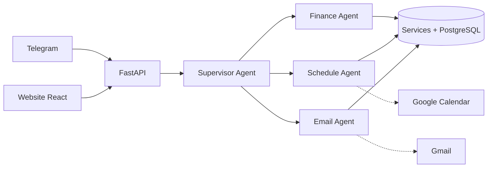

# Trợ lý cá nhân Multi-Agent (ReAct)

> Hệ thống nhiều AI agent theo khung **ReAct** giúp quản lý **chi tiêu**, **lịch sinh hoạt** và **email** hằng ngày — điều khiển qua **Telegram**, quản lý trên **website**, và **truy vết được chính xác prompt + tool** mà agent đã dùng ở từng bước.


> 🚧 Dự án đang được xây dựng **từng bước để vừa làm vừa học** — xem [Lộ trình](#lộ-trình). Ảnh demo sẽ được thêm ở bước 20.

---

## 1. Dự án giải quyết vấn đề gì?
- Ghi chi tiêu hằng ngày rất phiền → chỉ cần **nhắn, chụp hóa đơn hoặc nói** vào Telegram.
- Lịch và việc cần làm rời rạc → agent **gợi ý xếp việc vào khung giờ trống** và nhắc lịch.
- Hộp thư quá tải → agent **tóm tắt, phân loại, soạn nháp** — và **chỉ gửi khi bạn duyệt**.

## 2. Tính năng (dự kiến)
| Agent | Việc làm |
|---|---|
| **Finance** | Ghi thu/chi theo danh mục (ăn uống, di chuyển, mua sắm, giải trí, khác, thu nhập, phụ cấp gia đình); tổng chi, tổng thu, **chi ròng = chi − thu**; ngân sách |
| **Schedule** | Đặt lịch, tìm khung trống, gợi ý xếp việc, nhắc lịch, đồng bộ Google Calendar |
| **Email** | Thu thập, tóm tắt, phân loại mail; soạn nháp; gửi **sau khi người dùng duyệt** |
| **Supervisor** | Hiểu yêu cầu và giao việc cho đúng agent |
| **Briefing** | Bản tin 7h sáng & tổng kết 21h tối |

Thêm: đọc **ảnh hóa đơn** (Gemini vision) và **tin nhắn thoại** (faster-whisper chạy local).

## 3. Kiến trúc



Mọi agent được bao quanh bởi **7 harness**:

| Harness | Trách nhiệm | Thư mục |
|---|---|---|
| Context | Prompt, memory, skills, ghép ngữ cảnh | `backend/app/harness/context/` |
| Tool | Registry, schema, thực thi, mức rủi ro | `backend/app/harness/tools/` |
| Orchestration | Vòng ReAct, Supervisor, duyệt, job | `backend/app/harness/orchestration/` |
| Evaluation | Eval offline/online, chấm điểm | `backend/app/harness/evaluation/`, `backend/evals/` |
| Security | Xác thực, mã hoá, chống prompt injection | `backend/app/harness/security/` |
| Governance | Policy-as-code, audit, kill switch | `backend/app/harness/governance/` |
| AgentOps | Trace, metrics, cảnh báo | `backend/app/harness/agentops/` |

Chi tiết: [PLAN.md](PLAN.md) · [docs/02-architecture.md](docs/02-architecture.md)

## 4. Một yêu cầu được xử lý thế nào?
_Sẽ bổ sung ví dụ trace thật (Thought → Action → Observation) ở bước 2._

## 5. Kết quả benchmark
So sánh **single-agent vs multi-agent** về chất lượng, độ trễ, chi phí. Bảng dưới được **sinh tự động** bởi `backend/benchmarks/report.py` — không điền tay.

<!-- BENCH:START -->
_Chưa chạy — sẽ có ở bước 9 (lần 1) và bước 19 (đầy đủ)._
<!-- BENCH:END -->

## 6. Quyết định thiết kế (ADR)
| ADR | Quyết định | Trạng thái |
|---|---|---|
| [0001](docs/adr/0001-dung-adr.md) | Ghi lại quyết định kiến trúc bằng ADR | Accepted |
| [0002](docs/adr/0002-chon-llm-gemini.md) | Dùng Google Gemini qua SDK `google-genai` | Accepted |

Danh sách đầy đủ dự kiến: [docs/adr/README.md](docs/adr/README.md)

## 7. Bắt đầu nhanh (trạng thái hiện tại)
Yêu cầu: Python 3.11+, Git.

```powershell
git clone <repo-url>
cd <repo>
python -m venv .venv
.\.venv\Scripts\Activate.ps1
pip install -e "backend[dev]"
copy .env.example .env      # rồi điền khoá vào .env
pytest backend
```
Gemini API key lấy tại https://aistudio.google.com/apikey (điền `GEMINI_API_KEY` trong `.env`).

Thử bước 1 (gọi Gemini với một tool):
```powershell
python backend\experiments\step01_first_tool_call.py
```
Hướng dẫn Google OAuth, Telegram bot token sẽ được bổ sung ở các bước tương ứng.

## 8. Cấu trúc thư mục
```
PLAN.md            kế hoạch tổng thể
CLAUDE.md          quy ước dự án cho Claude Code
docs/              tài liệu thiết kế, ADR, nhật ký học, playbook
backend/app/       mã nguồn: harness/ (7 harness), agents/, services/, integrations/, api/, jobs/, db/
backend/evals/     bộ eval        backend/benchmarks/  benchmark single vs multi
backend/skills/    runtime skills (SKILL.md) cho agent
frontend/          website React (bước 13)
```

## 9. Lộ trình
| Giai đoạn | Bước | Trạng thái |
|---|---|---|
| 0. Chuẩn bị | 0 · Khung dự án, tài liệu nền, ADR-0001 | ✅ |
| 1. Hiểu ReAct từ gốc | 1 · Gọi Gemini + 1 tool ✅ · 2 · Vòng ReAct + tracer · 3 · Tool registry | 🔄 |
| 2. Finance Agent | 4 · DB + service + CLI · 5 · Eval đầu tiên · 6 · Trace DB + chi phí | ⬜ |
| 3. Điều phối | 7 · Schedule + planner · 8 · Single-agent · 9 · Multi-agent + benchmark | ⬜ |
| 4. An toàn | 10 · Gmail + chống injection · 11 · Duyệt + policy + audit | ⬜ |
| 5. Dùng thật | 12 · Telegram + memory · 13 · Web · 14 · Trace UI + realtime · 15 · GCal | ⬜ |
| 6. Mở rộng | 16 · Bản tin · 17 · Ảnh hóa đơn · 18 · Giọng nói | ⬜ |
| 7. Hoàn thiện | 19 · Benchmark đầy đủ · 20 · Docker, CI, demo, playbook | ⬜ |

Nhật ký học từng bước: [docs/learning/](docs/learning/)

## 10. Bài học rút ra
_Tổng kết ở [docs/playbook.md](docs/playbook.md) khi hoàn thành._
