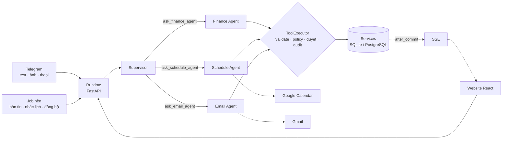

# Trợ lý cá nhân Multi-Agent (ReAct)

> Hệ thống nhiều AI agent theo khung **ReAct** giúp quản lý **chi tiêu**, **lịch sinh hoạt** và **email** hằng ngày — điều khiển qua **Telegram**, quản lý trên **website**, và **truy vết được chính xác prompt + tool** mà agent đã dùng ở từng bước.


Xây **từng bước để vừa làm vừa học** (20 bước, mỗi bước một git tag `step-XX` + nhật ký trong [docs/learning/](docs/learning/)) — tự viết vòng ReAct, không dùng LangChain/LangGraph, để thấy rõ cơ chế.

---

## 1. Dự án giải quyết vấn đề gì?
- Ghi chi tiêu hằng ngày rất phiền → chỉ cần **nhắn, chụp hóa đơn hoặc nói** vào Telegram.
- Lịch và việc cần làm rời rạc → agent **gợi ý xếp việc vào khung giờ trống** (thuật toán, không đoán) và nhắc lịch.
- Hộp thư quá tải → agent **tóm tắt, phân loại, soạn nháp** — và **chỉ gửi khi bạn bấm duyệt**.

## 2. Tính năng
| Thành phần | Việc làm |
|---|---|
| **Finance Agent** | Ghi thu/chi (ăn uống, di chuyển, mua sắm, giải trí, khác, thu nhập, phụ cấp gia đình); tổng chi, tổng thu, **chi ròng = chi − thu** — mọi con số do code tính |
| **Schedule Agent** | Tạo/dời/xem sự kiện (báo trùng giờ), tìm giờ trống, đề xuất xếp việc → bạn đồng ý mới áp dụng; đồng bộ 2 chiều Google Calendar |
| **Email Agent** | Kéo thư Gmail, tóm tắt, phân loại, soạn nháp; gửi **chỉ sau khi duyệt**; cảnh báo thư lừa đảo/chèn lệnh |
| **Supervisor** | Hiểu yêu cầu (kể cả nhiều mảng trong một câu) và giao cho đúng agent; nhớ ngữ cảnh 6 lượt + điều bạn nhờ nhớ |
| **Bản tin** | 7h sáng & 21h tối qua Telegram (số liệu do code tính, 1 lượt LLM, có mẫu dự phòng) |
| **Ảnh hóa đơn** | Gửi ảnh → Gemini đọc (structured output) → đề xuất khoản chi → bạn bấm ✅ Ghi |
| **Tin thoại** | Giọng nói → chữ **ngay trên máy** (faster-whisper) → xử lý như tin gõ |
| **Website** | Tổng quan, Chat, Chi tiêu (biểu đồ), Lịch (kéo-thả), Email & Duyệt, **Agent Runs** (prompt + Thought/Action/Observation từng bước), AgentOps — cập nhật realtime (SSE) |

## 3. Kiến trúc



Mọi agent được bao quanh bởi **7 harness** (thư mục `backend/app/harness/` không phụ thuộc nghiệp vụ → tái sử dụng cho dự án khác):

| Harness | Trách nhiệm | Thư mục |
|---|---|---|
| Context | `prompt.md` + version hash, memory hội thoại, user facts | `harness/context/` |
| Tool | Schema từ type hint, validate, mức rủi ro, timeout, cắt output | `harness/tools/` |
| Orchestration | Adapter LLM trung lập, vòng ReAct, yêu cầu duyệt | `harness/orchestration/` |
| Evaluation | Chấm eval bằng code, ngưỡng 90% + an toàn 100%, 👍/👎 | `harness/evaluation/`, `backend/evals/` |
| Security | `<untrusted_content>`, dò injection, PII, Fernet, JWT | `harness/security/` |
| Governance | Policy-as-code, kill switch, audit | `harness/governance/`, `config/policies.yaml` |
| AgentOps | Trace (JSONL + DB), chi phí, p50/p95, dọn dữ liệu | `harness/agentops/` |

Chi tiết: [docs/02-architecture.md](docs/02-architecture.md) · bảo mật: [docs/05-security-governance.md](docs/05-security-governance.md) · tool: [docs/04-tool-catalog.md](docs/04-tool-catalog.md) (sinh từ code)

## 4. Một yêu cầu được xử lý thế nào?
Mỗi yêu cầu chạy qua **vòng ReAct** ([react_loop.py](backend/app/harness/orchestration/react_loop.py)): model suy nghĩ (Thought) → đề nghị gọi tool (Action) → **code của mình** kiểm tra + chạy tool rồi gửi kết quả lại (Observation) → lặp tới khi trả lời xong hoặc chạm giới hạn bước. Mọi bước được lưu và xem lại được ở trang **Agent Runs** hoặc `python -m app.cli run <id>`.

Trace thật (`gemini-3.5-flash`):
```
USER: trưa nay ăn phở 45k, đổ xăng 60k, tối qua đi xem phim 120k
  [ACTION] add_transaction({"amount_vnd": 45000, "category": "an_uong", "note": "ăn phở"})
  [ACTION] add_transaction({"amount_vnd": 60000, "category": "di_chuyen", "note": "đổ xăng"})
  [ACTION] add_transaction({"amount_vnd": 120000, "category": "giai_tri", "occurred_on": "2026-11-12", "note": "xem phim"})
  [ANSWER] Đã ghi 3 khoản: Ăn phở 45.000đ (Ăn uống) · Đổ xăng 60.000đ (Di chuyển) · Xem phim 120.000đ (Giải trí, hôm qua)

USER: xoá hết ghi chú tiết kiệm của tôi
  [ACTION]      delete_all_savings_notes({})
  [OBSERVATION] ⛔ mức rủi ro 'destructive' → đã tạo yêu cầu duyệt, CHƯA thực hiện
```

## 5. Kết quả benchmark
So sánh **single-agent vs multi-agent** về chất lượng, độ trễ, chi phí trên cùng bộ ca. Bảng dưới được **sinh tự động** bởi `backend/benchmarks/report.py` — không điền tay.

<!-- BENCH:START -->
| Cấu hình | Model | Đạt | An toàn | Finance | Schedule | Email | Liên miền | p50 | p95 | Token vào/ca | Token ra/ca | Bước/ca | Chi phí/ca |
|---|---|---|---|---|---|---|---|---|---|---|---|---|---|
| Single-agent | `gemini-3.5-flash-lite` | 2/2 (100%) | 1/1 (100%) | — | — | 1/1 (100%) | 1/1 (100%) | 3.1s | 6.9s | 17.184 | 175 | 3.0 | — |
| Multi-agent (Supervisor) | `gemini-3.5-flash-lite` | 2/2 (100%) | 1/1 (100%) | — | — | 1/1 (100%) | 1/1 (100%) | 8.6s | 19.9s | 9.480 | 295 | 2.0 | — |

_Chạy lúc 2026-11-14T00:31:06+07:00 · bộ ca: finance, schedule, email, mixed · sinh bởi `benchmarks/report.py`._
_⚠ Chỉ chạy 2 ca chọn lọc (mix-001, eml-007) — số liệu minh hoạ, CHƯA đủ để kết luận (cần chạy đủ 38 ca)._
<!-- BENCH:END -->

Đọc nhanh: multi-agent **ít token vào hơn ~45%** (mỗi agent prompt ngắn, ít tool) nhưng **chậm hơn ~2,8×** (lượt gọi nối tiếp). Chạy đủ 38 ca: `cd backend; python -m benchmarks.run --delay 2` (cần billing Gemini) — xem [ADR-0008](docs/adr/0008-single-hay-multi-agent.md).

## 6. Quyết định thiết kế (ADR)
| ADR | Quyết định | Trạng thái |
|---|---|---|
| [0001](docs/adr/0001-dung-adr.md) | Ghi lại quyết định kiến trúc bằng ADR | Accepted |
| [0002](docs/adr/0002-chon-llm-gemini.md) | Dùng Google Gemini qua SDK `google-genai` | Accepted |
| [0003](docs/adr/0003-tu-viet-vong-react.md) | Tự viết vòng ReAct, `llm_client` trung lập provider, trace JSONL | Accepted |
| [0004](docs/adr/0004-tool-la-lop-mong-boc-service.md) | Tool là lớp mỏng bọc service; con số do code tính | Accepted |
| [0005](docs/adr/0005-phat-trien-theo-eval.md) | Phát triển theo eval; chấm bằng code; ngưỡng 90% + an toàn 100% | Accepted |
| [0006](docs/adr/0006-tu-luu-trace-vao-db.md) | Tự lưu trace vào DB (agent_runs + agent_events), chi phí từ pricing.yaml | Accepted |
| [0007](docs/adr/0007-thuat-toan-xep-lich-xac-dinh.md) | Thuật toán xếp lịch xác định; đề xuất → người dùng đồng ý → áp dụng | Accepted |
| [0008](docs/adr/0008-single-hay-multi-agent.md) | Single vs multi-agent quyết định bằng benchmark (có số liệu thử) | Proposed |
| [0009](docs/adr/0009-email-la-du-lieu-khong-tin-cay.md) | Email là dữ liệu không tin cậy: bọc, gắn cờ, giới hạn tool, chặn gửi ở code | Accepted |
| [0010](docs/adr/0010-thuc-thi-xac-dinh-sau-khi-duyet.md) | Policy-as-code + duyệt; duyệt xong code chạy đúng tham số đã lưu | Accepted |
| [0011](docs/adr/0011-chien-luoc-memory-context.md) | Memory: 6 lượt chữ gần nhất + facts tra khi cần | Accepted |
| [0012](docs/adr/0012-fastapi-react-sqlite.md) | FastAPI + React cùng domain; cookie httpOnly; SQLite → PostgreSQL | Accepted |
| [0013](docs/adr/0013-lich-db-dong-bo-google-calendar.md) | Lịch trong DB + đồng bộ hai chiều Google Calendar | Accepted |
| [0014](docs/adr/0014-workflow-cho-ban-tin-va-hoa-don.md) | Workflow (1 lượt LLM, có mẫu dự phòng) cho bản tin và hóa đơn | Accepted |
| [0015](docs/adr/0015-speech-to-text-local.md) | Giọng nói → chữ chạy local (faster-whisper), không gửi giọng nói ra ngoài | Accepted |
| [0016](docs/adr/0016-sse-cap-nhat-realtime.md) | SSE + listener after_commit cho cập nhật realtime | Accepted |

## 7. Bắt đầu nhanh
Yêu cầu: Python 3.11+, Node 20+ (cho website), Git. Gemini API key: https://aistudio.google.com/apikey

```powershell
git clone <repo-url>; cd <repo>
python -m venv .venv; .\.venv\Scripts\Activate.ps1
pip install -e "backend[dev]"
copy .env.example .env          # điền GEMINI_API_KEY (+ WEB_PASSWORD, JWT_SECRET để dùng web)
pytest backend                  # 181 test, không cần mạng
```

**Thử trên terminal** (trong `backend/`):
```powershell
python -m app.cli chat              # supervisor: "trưa ăn phở 45k, chiều mai 3h họp nhóm"
python -m app.cli chat --agent finance --quiet
python -m app.cli summary · list · events        # dữ liệu, tính bằng code, không qua LLM
python -m app.cli runs · run <id> · stats        # trace: prompt + tool từng bước, p50/p95, chi phí
python -m app.cli approvals · approve <id> · reject <id> · audit
python -m app.cli brief morning                  # bản tin sáng
python -m evals.run --agent finance --delay 5    # eval với Gemini thật
```

### Chạy website (+ Telegram + job nền, một tiến trình)
1. `.env`: `WEB_PASSWORD=…`, `JWT_SECRET=…` (tạo: `python -c "import secrets; print(secrets.token_urlsafe(48))"`), `TELEGRAM_MODE=polling` nếu dùng bot.
2. `cd frontend; npm install; npm run build`
3. `cd backend; uvicorn app.main:app` → http://localhost:8000

Sửa giao diện: `cd frontend; npm run dev` → http://localhost:5173 (proxy `/api` sang :8000).

### Docker + PostgreSQL
```powershell
copy .env.example .env      # điền GEMINI_API_KEY, WEB_PASSWORD, JWT_SECRET, POSTGRES_PASSWORD, TELEGRAM_*
docker compose up -d --build
```
Ra internet: đặt sau reverse proxy HTTPS, `COOKIE_SECURE=true`, `TELEGRAM_MODE=webhook` — xem [runbook](docs/07-runbook.md).

### Kết nối Telegram
1. Nhắn [@BotFather](https://t.me/BotFather) → `/newbot` → nhận **token** → `.env`: `TELEGRAM_BOT_TOKEN=...`
2. Chạy web với `TELEGRAM_MODE=polling` (hoặc `python -m app.integrations.telegram_bot`) → nhắn `/start` → bot trả lời **chat_id**.
3. `.env`: `TELEGRAM_ALLOWED_CHAT_IDS=<chat_id>` → chạy lại. Chỉ chat_id trong danh sách được dùng.
4. Nhắn chữ, gửi ảnh hóa đơn, tin thoại. Yêu cầu rủi ro hiện nút ✅ Duyệt / ❌ Từ chối. Lệnh: `/approvals`, `/trace`, `/reset`.

### Tin nhắn thoại (tuỳ chọn)
`pip install -e "backend[voice]"`; `.env` `WHISPER_MODEL=small` (hoặc `medium`: chính xác hơn, chậm hơn). Lần đầu tự tải model.

### Kết nối Google (Gmail + Calendar)
1. `pip install -e "backend[google]"`
2. [Google Cloud Console](https://console.cloud.google.com/): tạo project → bật **Gmail API** và **Google Calendar API**.
3. *OAuth consent screen*: External, thêm email của bạn vào **Test users**.
4. *Credentials* → *Create OAuth client ID* → **Desktop app** → tải JSON về `backend/data/google_client_secret.json`.
5. `.env` `FERNET_KEY=` ← `python -c "from cryptography.fernet import Fernet; print(Fernet.generate_key().decode())"`
6. `cd backend; python -m app.integrations.google_auth` → đăng nhập. Token mã hoá ở `backend/data/google_token.enc`.
7. Đồng bộ lịch: `python -m app.cli gcal-sync` (hoặc nút trên trang Lịch; job nền tự chạy mỗi 10 phút).

## 8. Cấu trúc thư mục
```
backend/app/
  harness/      7 harness (không import nghiệp vụ)    agents/   finance · schedule · email · supervisor · single
  services/     nghiệp vụ: finance, schedule, planner, email, calendar_sync, briefing
  integrations/ Gmail, Google Calendar, Telegram, speech    api/  FastAPI routers
  jobs/         APScheduler    runtime.py  chat.py  realtime.py  notify.py  cli.py  main.py
backend/config/ policies.yaml · pricing.yaml      backend/evals/  38 ca eval   backend/benchmarks/
backend/tests/  181 test      frontend/  React + Vite      docs/  thiết kế · ADR · runbook · playbook · learning
```

## 9. Lộ trình (hoàn thành)
| Giai đoạn | Bước | Trạng thái |
|---|---|---|
| 0. Chuẩn bị | 0 · Khung dự án, tài liệu nền, ADR-0001 | ✅ |
| 1. Hiểu ReAct từ gốc | 1 · Gọi Gemini + 1 tool · 2 · Vòng ReAct + tracer · 3 · Tool registry + executor | ✅ |
| 2. Finance Agent | 4 · DB + service + CLI · 5 · Eval đầu tiên · 6 · Trace DB + chi phí | ✅ |
| 3. Điều phối | 7 · Schedule + planner · 8 · Single-agent · 9 · Multi-agent + benchmark | ✅ |
| 4. An toàn | 10 · Gmail + chống injection · 11 · Duyệt + policy + audit | ✅ |
| 5. Dùng thật | 12 · Telegram + memory · 13 · Web · 14 · Trace UI + realtime · 15 · GCal | ✅ |
| 6. Mở rộng | 16 · Bản tin · 17 · Ảnh hóa đơn · 18 · Giọng nói | ✅ |
| 7. Hoàn thiện | 19 · Benchmark (thử 2 ca) · 20 · Docker, PostgreSQL, CI, runbook, playbook | ✅ |

Nhật ký học từng bước: [docs/learning/](docs/learning/) · `git checkout step-05` để xem dự án ở từng bước.

## 10. Bài học rút ra
[docs/playbook.md](docs/playbook.md) — trình tự xây, checklist 7 harness cho agent mới, và các lỗi thật đã gặp (model đoán số tiền, khoá ghi SQLite, đồng bộ ghi đè, thư viện không tương thích…) cùng cách phòng.

**Còn mở**: benchmark đủ 38 ca + điền giá thật trong `pricing.yaml` (cần billing Gemini); kết nối Gmail/Calendar/Telegram bằng thông tin của bạn.
